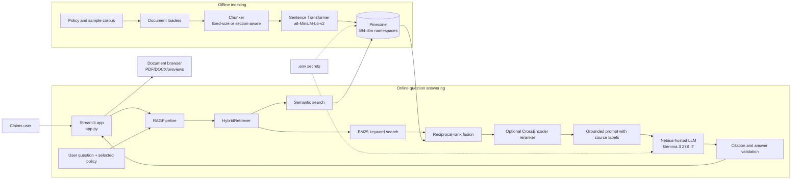

# AIClaimsAssist

AIClaimsAssist is a grounded knowledge assistant for auto-insurance claims and policy documents. It combines document extraction, configurable chunking, keyword and semantic retrieval, optional cross-encoder reranking, and citation-aware answer generation in a Streamlit interface.

The application is designed to answer questions for a selected policy while keeping the answer tied to retrieved evidence. When the evidence is missing or ambiguous, the pipeline reports that limitation instead of inventing coverage details.

## What it does

- Browse the available policy and claim documents.
- Extract text from PDF, DOCX, Markdown, CSV, TSV, and XLSX sources.
- Chunk documents using fixed-size or section-aware strategies.
- Search with keyword-only, semantic-only, or hybrid retrieval.
- Filter retrieval by policy ID.
- Optionally rerank the top candidates with a cross-encoder.
- Generate answers through a Nebius OpenAI-compatible endpoint.
- Validate source citations and show the supporting passages in the UI.
- Surface missing or uncertain information to the user.

## Architecture



### Request flow

1. The user selects a policy, retrieval mode, chunking strategy, and reranking option.
2. The question is sent to `RAGPipeline` with the selected policy ID.
3. `HybridRetriever` combines BM25 and Pinecone semantic results when hybrid mode is enabled.
4. The top candidates are optionally reranked with a cross-encoder.
5. The pipeline builds a prompt that treats retrieved documents as untrusted data and requires source labels such as `[Source 1]`.
6. The LLM response is checked for valid citations and displayed with the supporting passages and metadata.

## Project structure

```text
AIClaimsAssist/
├── app.py                         # Streamlit user interface
├── ingestion/
│   ├── document_loader.py         # PDF/DOCX extraction
│   ├── sample_loader.py           # Sample corpus and tabular loaders
│   ├── chunker.py                 # Production chunking
│   ├── sample_chunker.py          # Sample-corpus chunking
│   └── indexer.py                 # Embedding and Pinecone upsert
├── retrieval/
│   ├── bm25_retriever.py          # Keyword retrieval
│   ├── semantic_retriever.py      # Vector retrieval
│   ├── hybrid_retriever.py        # Retrieval fusion
│   └── reranker.py                # Cross-encoder reranking
├── generation/
│   └── rag_pipeline.py            # Prompting, generation, validation
├── scripts/
│   ├── index_documents.py         # Build both Pinecone namespaces
│   └── inspect_documents.py       # Inspect extraction results
├── data/
│   ├── policies/                  # Policy documents
│   └── sample/                    # Committed synthetic evaluation corpus
├── tests/                         # Unit and integration tests
└── requirements.txt
```

## Setup

Create and activate a virtual environment, then install the dependencies:

```powershell
python -m venv .venv
.\.venv\Scripts\Activate.ps1
pip install -r requirements.txt
```

Create `.env` from `.env.example` and fill in the service configuration. Do not commit `.env`.

```dotenv
PINECONE_API_KEY=your-pinecone-api-key
PINECONE_INDEX_NAME=aiclaimsassist
EMBEDDING_MODEL=sentence-transformers/all-MiniLM-L6-v2
NEBIUS_API_KEY=your-nebius-api-key
NEBIUS_BASE_URL=your-nebius-openai-compatible-base-url
```

The Pinecone index must be configured with dimension `384`, matching the default embedding model.

## Index the corpus

The indexer creates two Pinecone namespaces: `fixed-size` and `section-aware`.

```powershell
python scripts/index_documents.py
```

To index another corpus directory:

```powershell
$env:RAG_DATA_DIR = "C:\path\to\corpus"
python scripts/index_documents.py
```

Inspect PDF and DOCX extraction before indexing:

```powershell
python scripts/inspect_documents.py
python scripts/inspect_documents.py data\policies
```

## Run the application

```powershell
streamlit run app.py
```

Open the local Streamlit URL shown in the terminal. Choose a policy before asking a question. The Documents tab provides source previews; the Ask a question tab provides grounded answers, citations, retrieved passages, model metadata, and latency.

## Retrieval options

| Option | Behavior |
|---|---|
| `hybrid` | Combines BM25 keyword matches and Pinecone semantic matches using reciprocal-rank fusion. |
| `semantic_only` | Uses embedding similarity from Pinecone. |
| `keyword_only` | Uses the local BM25 index. |
| `fixed_size` | Splits extracted text into token-sized windows. |
| `section_aware` | Preserves heading-based sections where possible. |
| Reranking enabled | Uses a cross-encoder to reorder the strongest retrieved candidates before generation. |

## Testing

Run the test suite with:

```powershell
pytest
```

The tests cover document loading, chunking, indexing behavior, BM25 and hybrid retrieval, reranking, the RAG pipeline, the Streamlit app, and the committed sample corpus.

## Data and security notes

The committed sample corpus is synthetic and exists for local development and evaluation. It includes realistic-looking redaction-test material, including synthetic identity documents and PII spans; it does not represent real policyholders.

Keep API keys and service URLs in `.env` or another secret manager. The repository ignores `.env`, virtual environments, caches, bytecode, and Streamlit secrets. Never paste credentials into source files, notebooks, test fixtures, or committed data.

## License

No license has been declared yet. Add a `LICENSE` file before distributing the project publicly.
